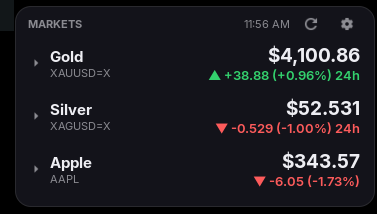
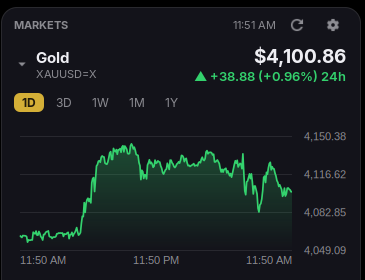

# Bullion Ticker

A customizable GNOME Shell desktop widget that tracks gold, silver, platinum,
palladium, stock indices and individual stocks. Each row shows the live price
and the day's change (green up, red down). Click a row to drop a chart down
below it: 1D, 3D, 1W, 1M or 1Y.

Supports GNOME Shell 45 through 50 (developed on 46 / Zorin OS).

   

## Features

- Live price with the day's change, green when up and red when down
- Expandable per-row chart with 1D / 3D / 1W / 1M / 1Y ranges
- Hover the chart for the exact price and time at any point
- Add, remove, rename and reorder trackers in preferences, with presets for
  common metals, indices and ETFs
- Colors (including background opacity), font, size, corner radius and chart
  height are all adjustable
- Floats above windows or sits on the desktop layer; drag the header to move
  it and lock the position when you like it
- Automatic fallback between data providers when one refuses requests

## Install

Clone the repo and link it into your extensions folder:

    git clone https://github.com/YOUR-USER/bullion-ticker.git && D=~/.local/share/gnome-shell/extensions/bullion-ticker@blanton.us && mkdir -p "$D" && cp -r bullion-ticker/{extension.js,prefs.js,chart.js,yahoo.js,providers.js,history.js,twelvedata.js,metadata.json,stylesheet.css,schemas} "$D" && glib-compile-schemas "$D/schemas"

Or from a release zip:

    D=~/.local/share/gnome-shell/extensions/bullion-ticker@blanton.us && mkdir -p "$D" && unzip -o bullion-ticker@blanton.us.zip -d "$D" && glib-compile-schemas "$D/schemas"

Then reload the shell so it notices the extension and enable it:

- **X11:** Alt+F2, type `r`, Enter
- **Wayland:** log out and back in (also required after every code update,
  because Wayland caches the extension modules)

```
gnome-extensions enable bullion-ticker@blanton.us
```

Preferences: `gnome-extensions prefs bullion-ticker@blanton.us`, or the gear
button on the widget.

Logs:

    journalctl -b -o cat /usr/bin/gnome-shell | grep "Bullion Ticker"

## Data sources

Prices are fetched in a chain; the first provider that answers wins.

| Order | Provider | Needs | Covers | History |
|-------|----------|-------|--------|---------|
| 1 | Yahoo Finance public chart endpoint | nothing | everything (metals, indices, stocks) | full, all ranges |
| 2 | [Twelve Data](https://twelvedata.com) | free API key | gold (`XAU/USD`), US stocks and ETFs | full, all ranges |
| 3 | [gold-api.com](https://gold-api.com) | nothing | gold, silver, platinum, palladium spot | current price only; the widget records it locally |

Yahoo is an unofficial endpoint and some networks get HTTP 429 from it. When
that happens the widget leaves Yahoo alone for 15 minutes and falls through the
chain.

### Twelve Data (optional)

Get a free key at twelvedata.com and paste it into Preferences > General. The
free plan allows 8 requests per minute and 800 per day, so calls are queued
8 seconds apart, charts are cached per range, and a rate-limit response starts
a cool-down (90 seconds for the per-minute limit, until 00:01 UTC for the daily
limit) followed by an automatic retry. The key is stored unencrypted in dconf.

The free plan does not include silver, platinum, palladium or index values like
the Dow. Use the ETF presets as stand-ins: `DIA`, `SPY`, `QQQ`, `SLV`, `PPLT`,
`PALL`, `GLD`.

### gold-api.com and the local recorder

gold-api.com has no history, so the widget records each price it sees to
`~/.local/share/bullion-ticker/history.json` (35 days of raw samples, thinned
to one per day up to 400 days). Charts for those metals fill in over time, the
x-axis is scaled by real time so gaps are honest, and the change shown is a
rolling 24h change (marked "24h") once about 10 minutes are recorded.

Force a source for a symbol with a prefix: `GOLDAPI:XAU` (also `XAG`, `XPT`,
`XPD`) or `TD:XAU/USD`.

### Symbols

| Market | Symbol | Note |
|--------|--------|------|
| Gold / silver spot | `XAUUSD=X`, `XAGUSD=X` | Yahoo currency pairs |
| Platinum / palladium | `PL=F`, `PA=F` | front-month futures |
| Gold / silver futures | `GC=F`, `SI=F` | |
| Dow Jones | `^DJI` | Yahoo only; use `DIA` as a stand-in |
| A stock | `AAPL`, `KO`, ... | |

If a symbol fails the row shows the provider's message. A ⚠ after the change
line means the latest refresh failed and the last good price is still shown.

## Settings at a glance

- **Trackers:** name, symbol, prefix, decimals, order, presets
- **Appearance:** background, text, muted, up, down, accent and line colors,
  chart trend coloring, font family and size, corner radius, chart height,
  show symbol
- **General:** refresh interval (1 to 60 min, default 15), default chart
  range, Twelve Data key, layer (desktop or above windows), lock position,
  reset position

## Notes

- "On the desktop" uses the shell's background layer. A desktop-icons extension
  that covers the whole desktop (Zorin's does) swallows clicks there; use
  "Floating above windows".
- The widget hides while the Overview is open.
- Refreshes are staggered and only stale rows are refetched, so changing a
  setting does not burn API credits.

## Development

Pure modules (`yahoo.js`, `chart.js`, `providers.js`, `history.js`,
`twelvedata.js`) import nothing from GNOME and can be unit-tested with plain
Node. `extension.js` and `prefs.js` need a running shell.

Testing a change: on X11 use Alt+F2, `r`; on Wayland you must log out and in.

## Roadmap / known gaps

- Silver, platinum and palladium history is limited to what has been recorded
  (a daily-history seed from another free source is the idea)
- Dow Jones index value is not available from the free fallback providers
- Desktop layer is blocked by Zorin's desktop-icons window
- Before publishing to extensions.gnome.org: trim `shell-version` to versions
  actually tested, review Yahoo's terms for a distributed extension, mention
  the private `Main.layoutManager._backgroundGroup` use in review notes,
  and upload the zip without `gschemas.compiled`

## License

GPL-2.0-or-later. See [LICENSE](LICENSE).
